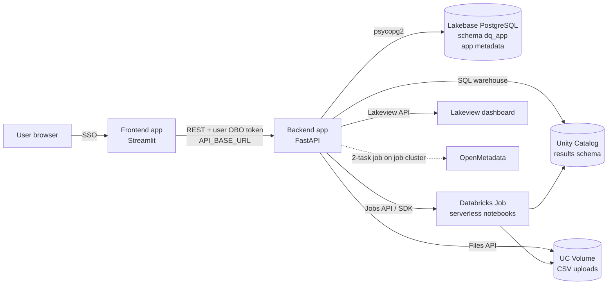
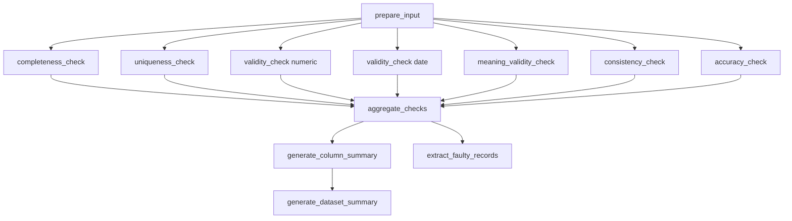

# Data Quality Self-Service platform

Self-service data quality application. Users describe a dataset, pick quality checks, deploy them as a Databricks Job, run or schedule it, then review scores, dashboards and faulty records. Results can be published to OpenMetadata.

The solution is made of two Databricks Apps:

| App | Tech | Folder | Role |
|---|---|---|---|
| Frontend | Streamlit 1.38 | [frontend/](frontend/) | UI: projects, jobs, 4-step workflow, reports |
| Backend | FastAPI | [backend/](backend/) | REST API, job deployment, metadata storage, report queries, OpenMetadata publishing |

The checks themselves run as PySpark notebooks ([backend/notebooks/](backend/notebooks/)) inside a Databricks Job created by the backend.

## Table of contents

1. [Architecture](#1-architecture)
2. [Repository layout](#2-repository-layout)
3. [User guide](#3-user-guide)
4. [Quality checks](#4-quality-checks)
5. [Execution pipeline and output tables](#5-execution-pipeline-and-output-tables)
6. [How metrics are calculated](#6-how-metrics-are-calculated)
7. [Reports, dashboard and faulty records](#7-reports-dashboard-and-faulty-records)
8. [OpenMetadata publishing](#8-openmetadata-publishing)
9. [Backend API](#9-backend-api)
10. [Configuration](#10-configuration)
11. [Setup and deployment](#11-setup-and-deployment)
12. [Local development and tests](#12-local-development-and-tests)
13. [Known limitations](#13-known-limitations)

---

## 1. Architecture



Responsibilities and storage:

| Concern | Where |
|---|---|
| App metadata (users, projects, jobs, executions, schedules, dashboards, OMD executions, project shares) | Lakebase PostgreSQL, schema `dq_app` |
| Uploaded CSV files | UC Volume `UC_UPLOAD_VOLUME/<username>/<project_id>/<file>` |
| Check results, summaries, faulty records | Unity Catalog `UC_CATALOG`.`UC_RESULTS_SCHEMA` (tables `dq_<project>_<job>_*`) |
| Check logic | Notebooks in [backend/notebooks/](backend/notebooks/), expected in the workspace at `/Workspace/Shared/notebooks/<notebook_name>` |

Authentication:

- Both apps use on-behalf-of-user (OBO) authentication (`on_behalf_of_user_authentication: true`). The frontend forwards the user token to the backend; the backend uses it to browse Unity Catalog (catalogs, schemas, tables, previews) so Unity Catalog permissions apply to the actual user.
- The backend also keeps the user token per request (`x-user-token` / `x-forwarded-access-token` / `Authorization: Bearer`) to open the Lakebase connection.
- Job creation, CSV upload, SQL warehouse queries and dashboard creation use an Azure Service Principal (`ARM_CLIENT_ID`, `ARM_CLIENT_SECRET`, `ARM_TENANT_ID`). If `DQ_PAT_TOKEN` is set, that PAT is used instead (temporary fallback in [backend/config/databricks_auth.py](backend/config/databricks_auth.py)).

---

## 2. Repository layout

```
backend/
  main.py                      FastAPI app, middleware, router registration
  api/                         Routers: users, projects, jobs, datasources
  services/                    Business logic (jobs, projects, datasources, deployment,
                               dashboard, OpenMetadata, Databricks client)
  database/                    Lakebase connection + repositories
  config/                      Settings (env vars) and Databricks auth
  models/schemas.py            Pydantic models
  notebooks/                   PySpark notebooks executed by the Databricks Job
  db_utils.py                  SQL warehouse connection (reads DQ result tables)
  schema.sql                   The only SQL script used to create/setup Lakebase tables
  unity_catalog_setup.sql      Unity Catalog schemas, upload volume and permissions setup
  optimize_tables.sql          Periodic Delta maintenance (OPTIMIZE / Z-ORDER) for app tables
  app.yaml, requirements.txt   Databricks App definition and dependencies
  app.yaml.example             Sanitized app.yaml template
frontend/
  app.py                       Redirects to pages/Tool.py
  pages/Tool.py                Main page
  api_client.py                HTTP client to the backend (OBO token handling)
  data_quality/                Workflow: projects, jobs, steps 1-4, components, report dashboard
  components/, utils/          Shared UI pieces and async loading helpers
  app.yaml, requirements.txt   Databricks App definition and dependencies
  app.yaml.example             Sanitized app.yaml template
tests/                         pytest tests (functional, performance)
scripts/, SBOM/                License-header and SBOM tooling (signed by .github/workflows/sbom-sign.yml)
```

---

## 3. User guide

### 3.1 Concepts

- **Project**: a container owned by a user; can be shared with other users by email (share/unshare), duplicated or deleted.
- **Job**: one data quality configuration inside a project (source + checks + thresholds). A job is deployed as one Databricks Job named `<project>_<job>`.
- **Execution**: one run of a job, tracked in `dq_executions` with the Databricks run id.

Navigation: Projects list -> Jobs of a project -> job workflow (4 steps). The current view, project, job and step are kept in the URL query parameters. Configuration is auto-saved to the job record as you move between steps.

### 3.2 Step 1 - Choose data source

Two source types:

| Source | Details |
|---|---|
| CSV import | Upload a file with its parsing options (separator, quote character, header, lines to skip). The file is stored in the UC Volume under `<UC_UPLOAD_VOLUME>/<username>/<project_id>/<file>`. Previously uploaded files can be reused or deleted. |
| Unity Catalog | Browse catalog -> schema -> table (filtered by the user's own Unity Catalog permissions) and preview the table. |

### 3.3 Step 2 - Configure quality controls

Pick one or more components, configure each one, then set thresholds.

| Component id | Name | Dimension in results |
|---|---|---|
| `completeness` | Completeness Check | `completeness` |
| `uniqueness` | Uniqueness Check | `uniqueness` |
| `validity_numeric` | Numeric Values Comparison | `validity` |
| `validity_date` | Date Values Comparison | `validity` |
| `meaning_validity` | Validity (format / data type) | `validity` |
| `consistency` | Consistency Check | `consistency` |
| `accuracy_custom_rules` | Custom Rules | `accuracy` |

Thresholds: for each controlled column (or each rule for custom rules) two sliders define the **Warning** and **OK** levels (UI defaults: warning 80, OK 95). Warning must be lower than OK. See [section 6.3](#63-status-ok--warning--ko).

### 3.4 Step 3 - Deploy

- Review and enable/disable each selected component.
- **Deploy** creates the Databricks Job (or updates the existing one on redeploy). Progress is streamed to the UI (Server-Sent Events). The job record (Databricks job id, URL, deployer, status `deployed`) is stored in Lakebase.
- Databricks Job settings: serverless environment, one notebook task per step, task timeout 3600 s, job timeout 7200 s, 1 concurrent run.

### 3.5 Step 4 - Run and schedule

- **Run now**: triggers the Databricks Job. The UI polls the run status; on completion it loads the report.
- **Schedule**: `daily`, `weekly`, `monthly` or `custom` (cron), with execution time and timezone. The backend converts the choice to a Quartz cron expression (7 fields) and sets it on the Databricks Job (unpaused); a 5-field Unix cron entered in custom mode is converted by prefixing seconds and suffixing year.
- **History**: past executions with status, launch user, dashboard link and OpenMetadata push status. Stale `running` executions older than 5 minutes are reconciled against Databricks when the history is loaded.
- **Results**: summary cards per dimension, column-level table, faulty records download, link to the Lakeview dashboard, publish to OpenMetadata.

---

## 4. Quality checks

Every check produces, per row and per check column, one of three values:

| Value | Meaning |
|---|---|
| `1` | The row passes the check |
| `0` | The row fails the check (faulty) |
| `NULL` | The check is not applicable for the row (missing input); excluded from scores |

Each notebook reads the prepared input table, writes one result table (`row_id`, one or more `*_check` columns, `execution_timestamp`) and overwrites it on each run (except validity, see [§13 Known limitations](#13-known-limitations)).

### 4.1 Completeness

Notebook: [completeness_check.ipynb](backend/notebooks/completeness_check.ipynb). Parameters: `columns`, `extra_empty_values`.

Per selected column, a row gets `1` if:

- the value is not `NULL`, and
- for `string`/`varchar` columns only: the trimmed value is not empty (`F.trim(value) != ""`) and the trimmed value does not equal any configured extra empty value (UI default list: `NA,N/A,NULL`).

Otherwise `0`. This check never returns `NULL`. Whitespace-only values (e.g. `"   "`) are treated as empty. Extra values are compared against the trimmed column value, case-sensitively, and only on string columns. Check column: `<column>_completeness_check`.

### 4.2 Uniqueness

Notebook: [uniqueness_check.ipynb](backend/notebooks/uniqueness_check.ipynb). Parameters: `columns`, `check_mode`, `fuzzy_sensitivity`.

Each selected column is checked independently (not as a composite key):

1. A grouping key is built per row:
   - **Exact Match**: the value cast to string.
   - **Fuzzy Match**: the value is cast to string, then a normalized prefix key is computed by `_make_fuzzy_key_udf(FUZZY_SENSITIVITY)`. Normalization: lowercase → strip → collapse whitespace → remove non-alphanumeric/space. The key is then truncated to `round(len × sensitivity / 100)` characters (min 4 if sensitivity ≥ 70, min 2 otherwise). At sensitivity ≥ 95 the full normalized string is used. This applies to all column types (non-string columns are cast to string first).
2. Rows are counted per key.
3. Result: `NULL` if the value is `NULL` or blank (after trim); `1` if the key occurs once; `0` if it occurs more than once. Every row of a duplicate group is flagged `0`, including the first occurrence.

`fuzzy_sensitivity` (0–100) controls how much of the normalized value must match for two entries to be considered duplicates. Higher values require a longer common prefix, producing fewer false positives. Check column: `<column>_uniqueness_check`.

### 4.3 Validity - numeric and date comparison

Notebook: [validity_check.ipynb](backend/notebooks/validity_check.ipynb). Parameters: `column_1`, `operator`, `column_2`, `check_type` (`numeric` or `date`).

Compares two columns row by row: `column_1 <operator> column_2`. Supported operators: `>`, `>=`, `<`, `<=`, `==`, `!=`. The shorthand `=` is normalised to `==` before evaluation, so both are accepted.

- `NULL` if either column is `NULL`.
- `1` if the comparison holds, otherwise `0`.
- `date` mode parses both columns with Spark's `to_date` using the format `dd/MM/yyyy` before comparing; a value that cannot be parsed is treated as `NULL`, so the row gets `NULL` (not scored).

Check column: `<column_1>_<operator_word>_<column_2>_validity_check`, where `operator_word` is `greater`, `greater_equal`, `less`, `less_equal`, `equal`, `not_equal`. The same name (without suffix) is the "column" shown in summaries.

**Write behaviour:** the notebook writes in `overwrite` mode (with `overwriteSchema`) the first time the `_validity` table does not exist, and in `append` mode with `mergeSchema` on subsequent runs. This allows numeric and date validity checks to coexist in the same table (different check columns). A retry loop (up to 3 attempts, 2 s apart) handles `ConcurrentAppendException` when both validity task types run in parallel.

### 4.4 Validity - format / meaning

Notebook: [meaning_validity_check.ipynb](backend/notebooks/meaning_validity_check.ipynb). Parameter: `column_types` (column -> expected type).

For each mapped column the value is validated against its type. `NULL`/blank values (after trim) always return `NULL`.

| Type (UI label) | Rule |
|---|---|
| `SIREN` | Non-digits removed, left-padded with zeros to 9 digits, Luhn checksum must be valid |
| `SIRET` | Same as SIREN with 14 digits |
| `French VAT` | Spaces and dots removed, uppercased; must match `^FR[A-Z0-9]{2}\d{9}$` and the 9-digit SIREN part must pass Luhn. The value `NONASSUJETTI` returns `NULL` |
| `Email` | `^[a-zA-Z0-9._%+-]+@[a-zA-Z0-9.-]+\.[a-zA-Z]{2,}$` |
| `Phone` | `^\+?[\d\s\-\(\)]{10,}$` |
| `Date YYYY-MM` | `^\d{4}-\d{2}$` (format only) |
| `Date DD/MM/YYYY` | `^\d{2}/\d{2}/\d{4}$` (format only, no calendar validation) |
| `postal_code`, `url`, `ipv4` | Implemented in the notebook (`^\d{5}$`, `^https?://[^\s]+$`, `^(\d{1,3}\.){3}\d{1,3}$`) but not offered in the UI |
| `Integer` | Trimmed value must match `^-?\d+$` (optional sign, digits only — no decimal point) |
| `Decimal` | Trimmed value must match `^-?\d*[.,]?\d+$` (dot or comma accepted as decimal separator) |
| `String` | Any non-null, non-blank value is valid (`1`); null/blank returns `NULL` (not scored) |
| `Boolean` | Trimmed, lowercased value must be one of `true`, `false`, `yes`, `no`, `1`, `0` |

Check column: `<column>_validity_check`. If a validity table already exists, the new result is merged with the existing check for the same column: `0` if any is `0`, `1` if all are `1`, otherwise the non-null value.

### 4.5 Consistency

Notebook: [consistency_check.ipynb](backend/notebooks/consistency_check.ipynb). Parameters: `column_a` (master), `column_b` (validation), `key_columns`, `check_mode`.

Row-level comparison of two columns:

- `NULL` if either column is `NULL`.
- `1` if `A = B`, otherwise `0`.
- `Exact Match`: native equality (type-sensitive). `Case Insensitive`: both values are cast to string, trimmed and lowercased before comparison.
- `key_columns` are accepted and logged but currently informational only; they do not change the result.

Check column: `<column_a>_vs_<column_b>_consistency_check`.

### 4.6 Accuracy - custom rules

Notebook: [accuracy_check.ipynb](backend/notebooks/accuracy_check.ipynb). Parameter: `custom_rules_json`.

A rule is an ordered list of conditions joined by `AND` / `OR`:

- Left column, operator, and a right operand (another column, or a literal value typed as text, numeric or date).
- Operators: `==`/`=`, `!=`, `>`, `>=`, `<`, `<=`, `is null`, `is not null`, `contains`, `not contains`.
- The conditions are translated to a Spark SQL expression and evaluated per row: `1` when the expression is true, `0` otherwise.
- `blank_when_not_applicable` (default `true`): if any column referenced by the rule is `NULL` or blank, the result is `NULL` instead.
- Disabled rules are ignored; at least one enabled rule is required. A legacy `condition` string syntax (`&&`, `||`, `arrayContains`, `abs(diff(...))`) is still translated.
- A literal that does not match its declared type (e.g. a non-numeric value typed numeric) only logs a warning.

Check column: `<first_rule_column>_<NNN>_accuracy_check`, with `NNN` the 1-based rule index. Rules sharing the same first column are merged during aggregation (see 6.1).

---

## 5. Execution pipeline and output tables

The Databricks Job is a DAG of notebook tasks built by [databricks_deployment_service.py](backend/services/databricks_deployment_service.py). A check task is only created if its component is enabled and configured (e.g. completeness without columns is skipped).



| Task | What it does |
|---|---|
| `prepare_input` | Reads the CSV (header, inferred schema) or the Unity Catalog table; sanitizes column names (every character outside `[a-zA-Z0-9_]` becomes `_`); adds `row_id` (`monotonically_increasing_id()`) and `execution_timestamp`; writes the `_input` table |
| check tasks | Run in parallel, see section 4 |
| `aggregate_checks` | Joins all check tables on `row_id` into one wide table |
| `generate_column_summary` | Counts and scores per (column, dimension) |
| `generate_dataset_summary` | Scores per dimension |
| `extract_faulty_records` | Keeps rows with at least one failed check and joins source values |

All tables are written as `<UC_CATALOG>.<UC_RESULTS_SCHEMA>.dq_<project>_<job>_<suffix>`, where `<project>` and `<job>` are the lowercased names with special characters replaced by `_`.

| Suffix | Content |
|---|---|
| `_input` | Source data + `row_id` + `execution_timestamp` |
| `_completeness`, `_uniqueness`, `_validity`, `_consistency`, `_accuracy` | One result table per dimension (`row_id`, `*_check` columns, `execution_timestamp`) |
| `_checks_aggregated` | `row_id` + one consolidated `<column>_<dimension>_check` per column and dimension |
| `_summary_columns` | `column_name, check_type, total_rows, valid_count, invalid_count, null_count, score, status, faulty_count, threshold_ok, threshold_warning, execution_timestamp` |
| `_summary_dataset` | `check_type, dataset_score, dataset_status, total_columns, columns_ok, columns_warning, columns_ko, execution_timestamp` |
| `_dq_faulty_records` | Faulty rows with source values, check results, `failed_checks`, `failure_count` |

---

## 6. How metrics are calculated

### 6.1 Consolidation per column and dimension

[aggregate_checks.ipynb](backend/notebooks/aggregate_checks.ipynb) groups the check columns of a dimension table by base column (the name without the `_NNN` rule index and the `_<dimension>_check` suffix). When several checks target the same base column (for example two accuracy rules on the same first column), they are merged:

- `0` if any check is `0`
- `1` if all checks are `1`
- `NULL` otherwise (all `NULL`, or a mix of `1` and `NULL`)

### 6.2 Column score

[generate_column_summary.ipynb](backend/notebooks/generate_column_summary.ipynb) computes, for each (column, dimension) over the aggregated table:

| Metric | Definition |
|---|---|
| `valid_count` | rows where the check is `1` |
| `invalid_count` | rows where the check is `0` |
| `null_count` | rows where the check is `NULL` |
| `total_rows` | all rows of the dataset |
| `faulty_count` | equal to `invalid_count` |
| `score` | $\dfrac{\text{valid\_count}}{\text{valid\_count}+\text{invalid\_count}} \times 100$, rounded to 2 decimals |

`NULL` rows are excluded from the denominator. If `valid_count + invalid_count = 0`, no score row is written for that column and dimension.

### 6.3 Status (OK / Warning / KO)

For a score $s$ with thresholds `ok` and `warning`:

$$
\text{status}=
\begin{cases}
\text{OK} & s \ge \text{ok}\\
\text{Warning} & \text{warning} \le s < \text{ok}\\
\text{KO} & s < \text{warning}
\end{cases}
$$

Thresholds are resolved per (dimension, column) from the `thresholds_json` built at deployment from the Step 2 sliders. When no threshold matches, the global defaults apply: OK = 100, Warning = 98 (`threshold_ok` / `threshold_warning`).

### 6.4 Dataset score per dimension

[generate_dataset_summary.ipynb](backend/notebooks/generate_dataset_summary.ipynb), for each enabled dimension:

- `dataset_score` = unweighted mean of the column scores of that dimension, rounded to 2 decimals.
- `dataset_status` = same rule as above, using the mean of the configured per-column OK and Warning thresholds of that dimension (global defaults if none).
- `columns_ok`, `columns_warning`, `columns_ko` = number of columns of the dimension per status; `total_columns` is their sum.

### 6.5 Overall score shown in the UI

The overall data quality score is the mean of the dimension scores (`dataset_score`) of the latest execution. In the job report card the colour is fixed: OK at 100, Warning from 98, KO below 98 (see [frontend/data_quality/jobs.py](frontend/data_quality/jobs.py)). The Lakeview dashboard uses the same average (`AVG(dataset_score)`).

---

## 7. Reports, dashboard and faulty records

- **Report**: the backend reads the rows of the latest `execution_timestamp` from `_summary_dataset` (dimension cards) and `_summary_columns` (faulty counts and rows analysed) through the SQL warehouse.
- **Lakeview dashboard**: created automatically after a run completes successfully (`DQ_Dashboard_<project>_<job>`), published on the SQL warehouse, stored in `dq_dashboards` and linked in the execution history. It shows OK / Warning / KO column counts, total rows and columns, overall score, one section per dimension (score and per-column details) and a threshold legend with a text summary. A column's dashboard status is its worst status across dimensions.
- **Faulty records**: `extract_faulty_records` keeps every row where at least one aggregated `*_check` equals `0`. Output columns are interleaved per source column (`col`, `col_<dimension>_check`, ...) followed by `failed_checks` (list of failed checks) and `failure_count`. The CSV download returns the table ordered by `failure_count` descending then `row_id`.

---

## 8. OpenMetadata publishing

Results of the latest run can be pushed to OpenMetadata from Step 4 by entering the asset fully qualified name (FQN). The FQN is saved on the job (`dq_jobs.omd_fqn`) and each publish is tracked in `dq_omd_executions` (`submitted` / `completed` / `failed`).

The backend submits a two-task Databricks run on a job cluster (the OpenMetadata API is on the internal network and is not reachable from serverless):

1. [prepare_dq_payload.ipynb](backend/notebooks/prepare_dq_payload.ipynb) reads the latest `_summary_columns` and `_summary_dataset` rows and builds a JSON payload.
2. [push_dq_to_omd.ipynb](backend/notebooks/push_dq_to_omd.ipynb) calls the OpenMetadata API:
   - ensures an executable test suite on the asset;
   - table-level test case `<table> dq summary`: status from the mean of the dataset scores - `Success` if >= 98, `Aborted` if >= 95, otherwise `Failed`; result values per dimension (completeness, validity, uniqueness, consistency);
   - column-level test cases for columns that exist in OpenMetadata, with the per-dimension scores as result values and the faulty counts in the description.

Requires `OMD_TOKEN` (secret) and `OMD_BASE_URL`; notebook paths and the job cluster are configured with the other `OMD_*` variables (see [section 10](#10-configuration)).

---

## 9. Backend API

Interactive documentation is served by FastAPI at `/docs`. Routers:

| Prefix | Main endpoints |
|---|---|
| `/api/users` | `POST /login`, `GET /{email}`, `POST /activity`, `GET ""` |
| `/api/dq/projects` | `POST /create`, `GET /user/{email}`, `GET/PUT/DELETE /{id}`, `POST /{id}/duplicate`, `GET /{id}/last-run-report`, `GET/POST /{id}/jobs`, `POST /{id}/share`, `POST /{id}/unshare`, `GET /shared/{user_id}` |
| `/api/dq` (jobs) | `POST /jobs/deploy` (SSE stream), `POST /jobs/{id}/run`, `GET/PUT/DELETE /jobs/{id}`, `GET /jobs/{id}/status`, `GET /jobs/{id}/executions`, `GET /jobs/{id}/runs/{run_id}/status`, `GET /jobs/{id}/runs/{run_id}/output`, `POST /jobs/{id}/schedule`, `GET /jobs/{id}/report`, `GET /jobs/{id}/faulty-records/download`, `GET /jobs/{id}/dashboards`, `GET /executions/{id}/dashboard`, `GET /executions/{id}/results` |
| `/api/dq` (OpenMetadata) | `POST /jobs/{id}/publish-to-openmetadata`, `GET /jobs/{id}/omd-executions`, `GET /jobs/{id}/omd-executions/latest-status`, `PATCH /jobs/{id}/omd-executions/{exec_id}/status`, `PATCH /jobs/{id}/omd-fqn` |
| `/api/datasources` | `GET /unity-catalog/catalogs|schemas|tables`, `POST /unity-catalog/preview`, `POST /csv/upload`, `POST /csv/save-to-project`, `GET /csv/list`, `GET /csv/preview`, `DELETE /csv/delete`, plus `/starburst/*` (Trino catalogs, schemas, tables, preview; not exposed in the UI) |
| `/`, `/api/` | Health and info |

`POST /api/dq/execute`, `/api/contracts/*` and `/api/monitoring/metrics` are placeholders (not implemented). `POST /api/dq/jobs/deploy_legacy` is the older non-streaming deploy endpoint, not used by the UI.

---

## 10. Configuration

Configuration is provided through [backend/app.yaml](backend/app.yaml) and [frontend/app.yaml](frontend/app.yaml); start from [backend/app.yaml.example](backend/app.yaml.example) and [frontend/app.yaml.example](frontend/app.yaml.example). Sensitive values are injected from app resources with `valueFrom`, never committed.

### Backend

| Variable | Purpose |
|---|---|
| `UC_CATALOG`, `UC_SCHEMA`, `UC_RESULTS_SCHEMA` | Unity Catalog catalog, app schema and results schema |
| `UC_UPLOAD_VOLUME` | UC Volume root for CSV uploads |
| `DATABRICKS_HOST`, `DATABRICKS_SERVER_HOSTNAME`, `DATABRICKS_HTTP_PATH` | Workspace and SQL warehouse used for result queries |
| `SERVERLESS_WAREHOUSE_ID` | SQL warehouse used for Lakeview dashboards |
| `ARM_CLIENT_ID`, `ARM_CLIENT_SECRET` (secret), `ARM_TENANT_ID` | Azure Service Principal for job creation and REST calls |
| `DQ_PAT_TOKEN` | Optional PAT that overrides the Service Principal |
| `PG_HOST`, `PG_PORT`, `PG_DATABASE`, `PG_USER`, `PG_SCHEMA`, `PG_SSLMODE` | Lakebase connection; the password is the injected `PGPASSWORD` (refreshed hourly by Databricks) or the request OBO token |
| `OMD_TOKEN` (secret), `OMD_BASE_URL`, `OMD_PAYLOAD_NOTEBOOK_PATH`, `OMD_PUSH_NOTEBOOK_PATH` (falls back to `OMD_NOTEBOOK_PATH`) | OpenMetadata publishing |
| `OMD_CLUSTER_SPARK_VERSION`, `OMD_CLUSTER_INSTANCE_POOL_ID`, `OMD_CLUSTER_DRIVER_INSTANCE_POOL_ID`, `OMD_CLUSTER_RUNTIME_ENGINE` | Job cluster used for the OpenMetadata run |
| `TRINO_HOST`, `TRINO_PORT`, `TRINO_USER`, `TRINO_PASSWORD` | Starburst/Trino endpoints (optional) |

The backend app also declares the `jobs` resource (`CAN_MANAGE_RUN`) and the Lakebase resource (`CAN_USE`). Prod and UAT workspace values are kept side by side (commented) in `app.yaml`; switch all of them together when changing environment.

### Frontend

| Variable | Purpose |
|---|---|
| `API_BASE_URL` | URL of the backend app |
| `DATABRICKS_SERVER_HOSTNAME`, `DATABRICKS_HTTP_PATH` | Workspace information |
| `STREAMLIT_SERVER_HEADLESS`, `STREAMLIT_SERVER_FILE_WATCHER_TYPE` | Streamlit runtime settings |

---

## 11. Setup and deployment

### 11.1 Prerequisites

- Databricks workspace with Unity Catalog, a SQL warehouse, serverless jobs and Lakebase.
- Unity Catalog objects: the catalog, the results schema (`UC_RESULTS_SCHEMA`) with write access for the job identity, and the upload Volume (`UC_UPLOAD_VOLUME`).
- Notebooks from [backend/notebooks/](backend/notebooks/) available under `/Workspace/Shared/notebooks/` (for example through a Git folder), with the exact names used by the backend: `prepare_input`, `completeness_check`, `uniqueness_check`, `validity_check`, `meaning_validity_check`, `consistency_check`, `accuracy_check`, `aggregate_checks`, `generate_column_summary`, `generate_dataset_summary`, `extract_faulty_records`, `prepare_dq_payload`, `push_dq_to_omd`.
- Azure Service Principal registered in the workspace with permission to create and run jobs, use the SQL warehouse and write to the results schema.

### 11.2 Lakebase database

Use [backend/schema.sql](backend/schema.sql) as the Lakebase setup script. Connect to the Lakebase PostgreSQL database used by the backend (the script's database grant currently names `db_gdm_data_quality_app`), then run the script in the Databricks SQL Editor with an account authorized to create the `databricks_auth` extension and grant database/schema permissions.

The script creates the `dq_app` schema, configures the service-principal role and permissions, and creates the application tables.

Before running it:

- Replace each `<DATABRICKS_CLIENT_ID>` placeholder with the backend app's service-principal client ID.
- The script grants access to all tables after creating them. After the script completes, run this grant again for the backend role so it receives access to the newly created tables.

```sql
GRANT SELECT, INSERT, UPDATE, DELETE ON ALL TABLES IN SCHEMA dq_app
TO "<DATABRICKS_CLIENT_ID>";
```

### 11.3 Unity Catalog database

Use [backend/unity_catalog_setup.sql](backend/unity_catalog_setup.sql) to provision the Unity Catalog resources and permissions required by the app. Run the commands in a Databricks SQL Editor with an identity authorized to create schemas and volumes and grant privileges.

Before running the script, replace the placeholders with the values for your environment:

- `<uc_catalog>`: the Unity Catalog catalog used by the app.
- `<uc_schema>`: the application schema, including the schema containing the upload volume.
- `<DATABRICKS_SERVICE_PRINCIPAL>`: the service principal used by the Databricks job.
- `<DATABRICKS_BACKEND_SERVICE_PRINCIPAL>`: the backend app's service principal.

The script creates the application schema, the `dq_uploads` volume, and the `db_gdm_dq_results` schema. It grants schema and volume access and gives the job service principal permissions to create and modify result tables. These are the setup objects and grants; result tables are populated by job runs.

### 11.4 Deploy the apps

Using the Databricks CLI (workspace paths are examples):

```bash
databricks sync ./backend  "/Workspace/Users/<you>/GDM%20SS/backend"  --full
databricks sync ./frontend "/Workspace/Users/<you>/GDM%20SS/frontend" --full
databricks apps deploy data-quality-tool-backend --source-code-path "/Workspace/Users/<you>/GDM%20SS/backend"
databricks apps deploy data-quality-tool-frontend  --source-code-path "/Workspace/Users/<you>/GDM%20SS/frontend"
```

After deployment, set `API_BASE_URL` in the frontend `app.yaml` to the backend app URL.

---

## 12. Local development and tests

OBO tokens exist only inside Databricks Apps; locally the clients fall back to the Databricks SDK / environment credentials.

```bash
# Backend
cd backend
pip install -r requirements.txt
# provide the variables of section 10 (a .env file is supported by pydantic-settings)
uvicorn main:app --host 0.0.0.0 --port 8000

# Frontend
cd frontend
pip install -r requirements.txt
API_BASE_URL=http://localhost:8000 streamlit run app.py
```

Tests (from the repository root):

```bash
pip install -r tests/requirements-test.txt
pytest
```

[pytest.ini](pytest.ini) points to `tests/`. The current tests ([tests/test_functional.py](tests/test_functional.py), [tests/test_performance.py](tests/test_performance.py)) cover frontend session-state and caching behaviour with mocks; the backend and the notebooks are not covered by automated tests.

---

## 13. Known limitations

Behaviours observed in the current code that users and maintainers should be aware of:

1. ~~**Operator `=` in comparison checks**~~ *(fixed)*: the notebook now normalises `=` to `==` before evaluation, so the UI's `=` option no longer causes a task failure.
2. **Date comparison format** is fixed to `dd/MM/yyyy` in `validity_check`. Dates in other formats will be parsed as `NULL` and excluded from scoring.
3. **Consistency key columns** have no effect on the result.
4. **Per-column thresholds** are matched on the column name appearing in the results. For comparison-based checks (numeric/date comparison, consistency) that name is composite (`a_greater_b`, `a_vs_b`), so thresholds set on individual columns do not match and the global defaults (OK 100 / Warning 98) apply.
5. **`overall` check**: `aggregate_checks` and the summaries support a per-column `overall` check, but the deployed job does not pass the `columns` parameter to `aggregate_checks`, so it is not produced. As a consequence the column-level test cases pushed to OpenMetadata default to `Failed` (their status is derived from the `overall` row).
6. **Validity table on re-run**: `validity_check` appends to an existing `_validity` table (overwrite only on the very first run). Re-running a job adds new rows alongside previous ones rather than replacing them, so summaries and faulty-record queries may include stale rows from earlier executions. A future improvement would be to filter result tables by the current `execution_timestamp` throughout the pipeline.
7. **Faulty records table** is not rewritten when a run finds no faulty rows, so a table from an earlier run can remain.
8. **SIREN / SIRET length**: values longer than 9/14 digits are truncated by the padding step before the Luhn check, so the full input is not validated.
